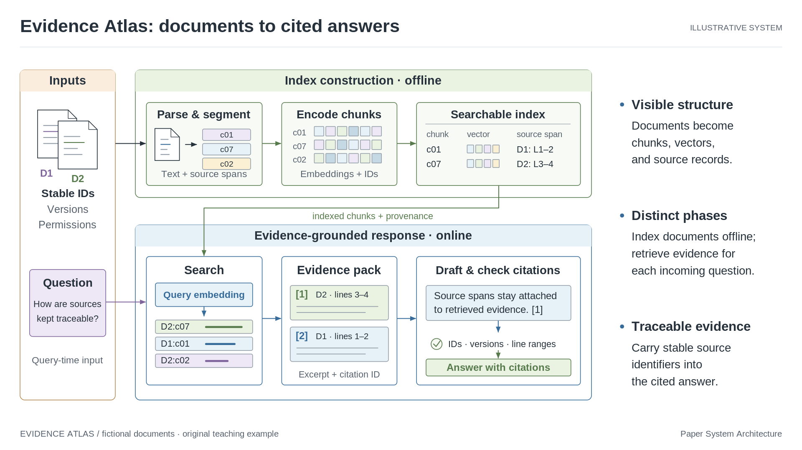
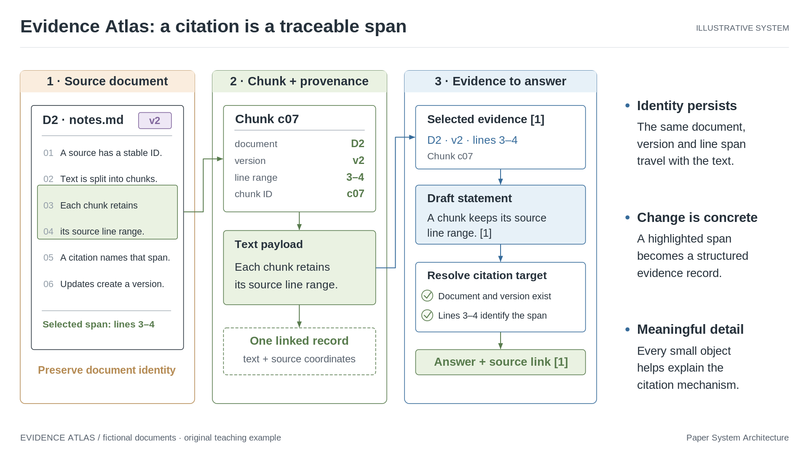

# Paper System Architecture

**Research figures with clear hierarchy, visible mechanisms, and editable structure.**

An agent skill for turning a paper, codebase, or technical brief into an information-rich architecture or mechanism diagram. It teaches how to allocate space, unpack a core operation, make ownership and state changes visible, and route meaningful connections.

[中文说明](README.zh-CN.md) · [Skill](skills/paper-system-architecture/SKILL.md) · [Visual language](skills/paper-system-architecture/references/research-visual-language.md) · [Examples](skills/paper-system-architecture/references/examples.md)



## What it does

- Organizes three levels of reading: architecture, mechanism, and concrete detail.
- Combines semantic frames, recognizable object icons and concrete mechanism illustrations, with a [visual construction guide](skills/paper-system-architecture/references/visual-construction.md) for turning concepts into drawings.
- Uses restrained pastel panels, graphite lines, meaningful icons throughout key components, and readable text.
- Supports paper figures and technical slides, using image-concept exploration when a new spatial design is still open.
- Keeps data, control, feedback, and ownership accurate.
- Defaults to Python-authored SVG/spec → FigGenie native PPT → rendered-output review; includes the multi-page export adapter and supports explicit SVG-only or draw.io requests.
- Refines observed defects and finishes when the requested result is satisfied, without mandatory iteration or finding quotas.

The bundled examples are original illustrations of a fictional document system. The repository includes editable SVG, preview PNG, semantic JSON, and a generator.

## Use it

Clone this repository and give your agent the path to `skills/paper-system-architecture/SKILL.md`. For automatic skill discovery, copy the complete `skills/paper-system-architecture` folder into your agent's configured skill directory. Keep its references and assets together. Avoid overwriting an existing customized installation unintentionally.

```text
Use paper-system-architecture to draw this project's method overview.
Read the project instructions and relevant source before choosing the flow.
Inspect the bundled examples and use the white research visual profile.
Expand the core mechanism with concrete structures and state changes.
Use the default route and deliver native editable PPT, SVG/spec and a PNG preview.
```

For a presentation, specify the slide count, aspect ratio, audience, and desired output. For a paper, specify the final column width. The default production route is **Python-authored SVG + semantic JSON → FigGenie native PPT → LibreOffice/PDF/PNG inspection**. Use image-concept exploration first when a new spatial design is still open; settled layouts and existing-vector edits start directly from vector authoring. Image generation and PPT conversion need the separate capabilities listed below. Explicit format requests take precedence.

Intended use and file format are separate choices. A standalone figure can use PowerPoint as an editable vector format. A presentation defaults to a large left diagram and right-hand round-bullet takeaways. In either PowerPoint use, the diagram's text, shapes and connectors remain native and editable, including the left diagram on a presentation slide; takeaways remain editable too.

## A worked mechanism



The example exposes a provenance record and carries one source span through the figure. The diagram's details explain its mechanism rather than serving as ornament.

## Optional tools

| Task | Dependency |
| --- | --- |
| Read and apply the design skill | An agent that can read Markdown and inspect images |
| Regenerate the example previews | Python 3.10+ and CairoSVG; `requirements-examples.txt` |
| Native PowerPoint export | `python-pptx`, `lxml`, and a separate compatible [FigGenie](https://github.com/Sleepy-Avacado/FigGenie-paper-diagram-skill) installation |
| draw.io output | An available editable draw.io authoring/rendering workflow |
| Raster concept exploration | An available image-generation tool |

See the [native export guide](skills/paper-system-architecture/references/native-powerpoint.md). This repository provides the design workflow and multi-page adapter, not a bundled SVG conversion engine.

## Develop and verify

```bash
python -m pip install -r requirements-examples.txt
python tools/build_examples.py
python -m unittest discover -s tests -v
```

The tests check the package's internal links, SVG/spec integrity, self-contained assets, and the export adapter's request validation. Inspect rendered figures as well; automated checks do not judge the scientific story or visual taste.

## License and references

MIT for this repository's instructions, code and original examples. External converters retain their own licenses. Public-paper references are linked for study; their figures are not redistributed. See [THIRD_PARTY.md](THIRD_PARTY.md).
