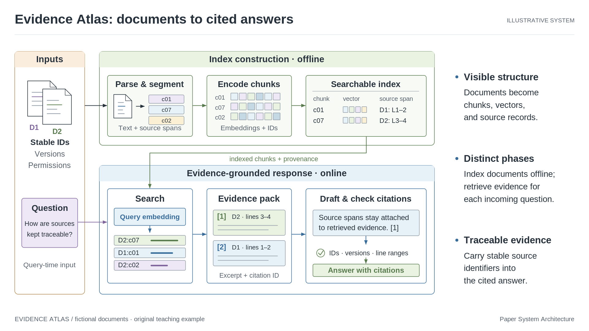
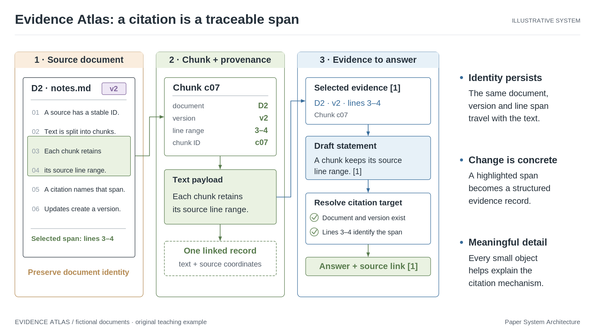

# Paper System Architecture

**把科研系统画得层次清楚、机制具体、细节丰富，并保持可编辑。**

这个技能适合论文方法总览、系统架构图、机制图和技术汇报。目标是：远看懂架构，中看懂过程，近看有技术细节。

[English](README.md) · [技能入口](skills/paper-system-architecture/SKILL.md) · [风格规范](skills/paper-system-architecture/references/research-visual-language.md) · [参考案例](skills/paper-system-architecture/references/examples.md)



## 视觉与工作方式

- **框线表达关系，图标辨认对象，图示讲清结构与变化，文字为它们命名。** 关键机制要展开为具体图形，不能停留在一组文字框；参见[图形构建方法](skills/paper-system-architecture/references/visual-construction.md)。
- 白底、淡色语义分区、深灰细线；主动为关键角色、输入输出、工具和操作配上统一的简笔图标，与短标签和具体结构配合。
- 给核心机制足够空间，在模块内部展开真实结构、中间产物和状态变化。
- 先核对职责、输入输出、归属和时序，再确定箭头。
- 默认走“Python 绘制 SVG 与结构 JSON → FigGenie 转原生可编辑 PPT → 渲染实际 PPT 检查”；新构图尚未确定时优先生图探索，布局已明确或已有图局部修改直接从矢量源文件开始。
- 按实际问题修正，保留已认可区域；没有强制迭代轮数、缺陷数量或自评分门槛。
- 在最终交付格式中检查字体、端点、线条和留白。

## 使用

把 `skills/paper-system-architecture/SKILL.md` 的路径交给协作者，或把完整技能目录放入所用 Agent 配置的技能目录。保留 `references`、`assets` 和 `scripts`。已有定制版本时使用独立副本。

可直接复制：

```text
请使用 paper-system-architecture，为当前项目绘制科研架构或机制图。

内容来源：[项目目录 / 方法说明 / 相关代码]
用途：[独立科研图 / 论文插图 / 汇报幻灯片]
交付：[SVG+PNG / 原生可编辑PPT / draw.io]

先阅读项目规范、相关实现和技能中的风格说明，实际查看附带案例。
采用白底、淡色分区、深灰细线、简洁线描和有主次的布局。
主动为关键角色、输入输出、工具和操作配图标，保持统一风格和可编辑性。
信息密度来自真实结构、具体对象、中间产物和状态变化。
展开最重要的机制，准确表达模块归属、数据流、控制条件与反馈。
在排框前明确“对象用什么图标、结构如何画、操作呈现什么变化”。
核心机制用图示展开，不能只在文字框旁加图标。
模块、算法和连接完全依据当前项目；示例只提供组织方法和视觉语言。
如果制作汇报幻灯片，使用紧凑标题、左侧大主图和右侧圆点要点。
汇报PPT的左图文字、形状、连线及右侧要点都要原生可编辑。
独立科研图也可以用PPT作矢量格式；它按图本身构图，无需套汇报页版式。
图中保留可读的标签、接口、图例与必要示例，不塞小字解释句。
解释放在汇报页右侧要点，或独立图的图注、正文中。
默认用Python绘制SVG与结构JSON，通过FigGenie转成PPT原生对象，
渲染实际PPT后检查文字、连线和留白；新构图未确定时优先生图探索。
已有图局部修改直接改矢量源文件；明确指定其他格式时按指定格式交付。
检查最终渲染，修正实际问题，完成后交付。
```

## 机制示例



两个案例是为本仓库制作的虚构文档系统示意图，包含 SVG、PNG、结构说明和生成脚本。它们用于演示设计方法，没有实验性能主张。

## 可选工具

核心技能直接提供设计流程。重建示例预览需要 CairoSVG；原生 PPT 导出另需 `python-pptx`、`lxml` 和兼容的 [FigGenie](https://github.com/Sleepy-Avacado/FigGenie-paper-diagram-skill) 安装，详见[导出说明](skills/paper-system-architecture/references/native-powerpoint.md)。draw.io 和生图分别使用当前环境提供的工具。

```bash
python -m pip install -r requirements-examples.txt
python tools/build_examples.py
python -m unittest discover -s tests -v
```

本仓库的说明、代码和原创案例采用 MIT 许可证。论文图仅提供来源链接；外部工具遵循各自许可证，见 [THIRD_PARTY.md](THIRD_PARTY.md)。
